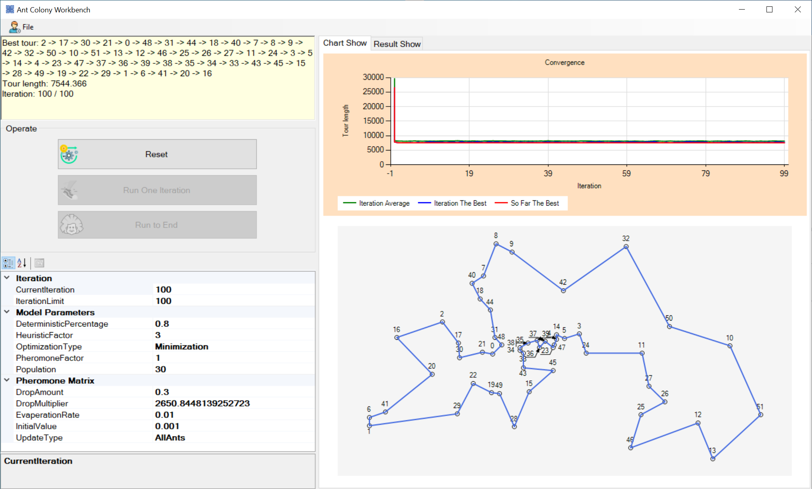

<div align="center">

# 🐜 Ant Colony Workbench

**A portable Windows application for solving travelling-salesman problems with Ant Colony System optimisation and 2-opt local search.**

[](https://learn.microsoft.com/dotnet/csharp/)
[](https://dotnet.microsoft.com/)
[](https://learn.microsoft.com/dotnet/desktop/winforms/)
[](#how-the-solver-works)
[](#tsplib-input)
[](#download-and-run)
[](LICENSE)

**Open a TSPLIB map → build a colony → watch pheromone trails become a near-optimal route.**

[Download and run](#download-and-run) · [Screenshot](#screenshot) · [Solver](#how-the-solver-works) · [Build](#build-from-source)

</div>

---

## Download and run

The ready-to-use application is in [`release/`](release/):

| Item | Path |
|---|---|
| Portable folder | `release/AntColonyWorkbench/` |
| ZIP package | `release/AntColonyWorkbench-win64.zip` |

1. Extract the ZIP (or open the portable folder).
2. Double-click **`Launch.cmd`**, or run **`AntColonyWorkbench.exe`** directly.
3. No installation or administrator rights are required. Windows 10/11 includes the .NET Framework 4.8 runtime.

The folder is self-contained: the executable, solver library, sample instances, license, and a short `README.txt` stay together.

### Demo mode

```powershell
AntColonyWorkbench.exe --demo samples\berlin52.tsp --run 100
```

This loads a bundled map, runs 100 iterations, and opens the window with the route, convergence chart, and pheromone matrix already populated. Any TSPLIB file can also be supplied directly:

```powershell
AntColonyWorkbench.exe C:\maps\my-city.tsp
```

---

## Screenshot

<div align="center">
  
  <br>
  <em>Ant Colony Workbench after 100 iterations on <code>berlin52</code>. The route map, convergence chart, editable model parameters, and pheromone inspector are visible in one window.</em>
</div>

---

## What it does

The application finds short Hamiltonian cycles for symmetric travelling-salesman instances:

- reads TSPLIB `EUC_2D`, `CEIL_2D`, and pseudo-Euclidean `ATT` coordinates;
- constructs tours with the Ant Colony System transition rule;
- improves every constructed tour with bounded 2-opt local search;
- evaporates and reinforces pheromone trails after each iteration;
- plots iteration-best, so-far-best, and population-average tour lengths;
- displays the best route, the best length, and the learned pheromone matrix;
- exposes population size, pheromone factor, heuristic factor, deterministic percentage, evaporation rate, deposit amount, and update mode in a property grid.

### Measured results

| Instance | Cities | Optimum | Result | Gap |
|---|---:|---:|---:|---:|
| `berlin52` | 52 | 7542 | **7544.37** | **0.03 %** |
| `att48` | 48 | 10628 | **10638** | **0.09 %** |

Results are stochastic; different runs may produce slightly different tour lengths.

---

## How the solver works

### Construction

At each step an ant moves from city `i` to an unvisited city `j`:

- with probability `q₀` it chooses the city maximising `τᵢⱼ^α · ηᵢⱼ^β`;
- otherwise it samples from the normalised distribution `τᵢⱼ^α · ηᵢⱼ^β`.

`τ` is pheromone, `η = 1 / distance`, `α` is the pheromone factor, `β` is the heuristic factor, and `q₀` is the deterministic percentage.

### 2-opt improvement

For each pair of non-adjacent edges `(a,b)` and `(c,d)`, the tour is reversed between them when:

```text
d(a,b) + d(c,d) > d(a,c) + d(b,d)
```

The number of passes is capped so large instances remain responsive.

### Pheromone update

1. Evaporate every edge: `τᵢⱼ ← (1 − ρ) τᵢⱼ`.
2. Deposit on all ant tours or only the best tour: `τᵢⱼ ← τᵢⱼ + Q / L`.
3. Apply updates symmetrically because TSP distances are symmetric.

### Controls

| Control | Action |
|---|---|
| **File → Open** | Load a TSPLIB `.tsp` instance. |
| **Reset** | Rebuild the colony and redraw the initial best tour. |
| **Run One Iteration** | Advance one construction and update cycle. |
| **Run to End** | Run until the iteration limit. |
| **Chart Show** | Inspect convergence. |
| **Result Show** | Inspect ant tours and the pheromone matrix. |
| **Property grid** | Edit parameters, then press **Reset** to apply them. |

---

## TSPLIB input

```text
NAME: berlin52
TYPE: TSP
COMMENT: 52 locations in Berlin
DIMENSION: 52
EDGE_WEIGHT_TYPE: EUC_2D
NODE_COORD_SECTION
1 565.0 575.0
2 25.0 185.0
...
EOF
```

Supported edge weights:

| Type | Distance |
|---|---|
| `EUC_2D` | Euclidean distance |
| `CEIL_2D` | Euclidean distance rounded up |
| `ATT` | Pseudo-Euclidean formula used by the `att` instances |

Malformed dimensions, missing cities, duplicate rows, and unsupported edge types are rejected with a readable message.

---

## Project structure

```text
AntColonySystem/
├── ACO Optimization System for theTSPs/
│   ├── AntColonySystem/                 # reusable solver library
│   ├── AntColonyWorkbench/              # WinForms application
│   └── AntColonyWorkbench.sln
├── samples/
│   ├── berlin52.tsp
│   └── att48.tsp
├── release/
│   ├── AntColonyWorkbench/              # ready-to-run portable app
│   └── AntColonyWorkbench-win64.zip
├── docs/screenshots/main.png
├── README.md
└── LICENSE
```

---

## Build from source

**Requirements:** Windows 10/11, Visual Studio 2022/2026 with .NET desktop development, or MSBuild with the .NET Framework 4.8 targeting pack.

```powershell
& 'C:\Program Files\Microsoft Visual Studio\18\Community\MSBuild\Current\Bin\MSBuild.exe' `
  '.\ACO Optimization System for theTSPs\AntColonyWorkbench.sln' `
  /t:Restore,Build /p:Configuration=Release /v:minimal /nologo
```

The executable appears at:

```text
ACO Optimization System for theTSPs\AntColonyWorkbench\bin\Release\AntColonyWorkbench.exe
```

Use MSBuild rather than `dotnet build`: this is a classic .NET Framework WinForms project.

---

## Design notes

- **Valid tours under all pheromone values** — roulette selection clamps its index and falls back to uniform choice if the cumulative weight is invalid.
- **Symmetric trail updates** — both directions of every edge are reinforced.
- **Length-scaled deposits** — shorter tours attract more pheromone.
- **Initialised best tour** — `Reset` evaluates initial tours, so the UI never shows an empty or `double.MaxValue` result.
- **Chart integrity** — every series is attached to an explicit chart area, and the route closes back to its first city.
- **Input validation** — unsupported edge weights and malformed coordinates produce a clear warning instead of an exception.

---

## References

- Dorigo, M., & Gambardella, L. M. (1997). *Ant Colony System: A Cooperative Learning Approach to the Traveling Salesman Problem.* IEEE Transactions on Evolutionary Computation, 1(1), 53–66.
- Dorigo, M., & Stützle, T. (2004). *Ant Colony Optimization.* MIT Press.
- Reinelt, G. (1991). *TSPLIB—A Traveling Salesman Problem Library.* ORSA Journal on Computing, 3(4), 376–384.

---

## License

MIT License. See [LICENSE](LICENSE).

<div align="center">

Built with 🐜, 🧠 and C# by **Benny Lin**  
[GitHub @BennyLinntu](https://github.com/BennyLinntu)

</div>
